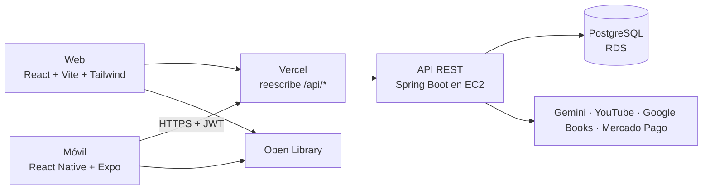

# RumboU · Frontend

Web y app móvil de **RumboU**, la plataforma de preparación para el examen de admisión de la UNI y la UNMSM. Consume la API de [`rumbou-backend`](https://github.com/marcobautista-sketch/rumbou-backend).

CS 2031 Desarrollo Basado en Plataformas (UTEC).

- **Integrantes:** Marco Emilio Bautista Ortega, Fabiana Marcela Gomez Chavez, Juan Carlos Alexander Vergara Montalván y Zoe Camila Garrido Cantoni

## En producción

| Parte | Dónde | URL |
| --- | --- | --- |
| API REST | AWS EC2 detrás de nginx con HTTPS, base en RDS PostgreSQL | `https://184-194-122-22.sslip.io/api/v1` (salud: `/api/v1/health`) |
| Web | Vercel | https://rumbou-frontend.vercel.app |
| Móvil | Expo Go con EAS Update (proyecto `@rumbou/rumbou`, canal `preview`) | Entra a la API por el mismo dominio de la web |

## Arquitectura



Las dos apps siguen las mismas capas:

- `api/` (web) y `services/` (móvil): cliente axios con `baseURL`, timeout e interceptores que agregan el `Authorization: Bearer` y renuevan el token cuando la API responde 401.
- `contexts/` y `hooks/`: sesión del usuario (`AuthContext`), tema y lógica reutilizable (`useFetch`, `usePagination`, `useDebounce`).
- `components/`, `pages/` y `screens/`: la interfaz.

**Sesión.** En la web el access token vive solo en memoria y el refresh token en una cookie `HttpOnly`, así que ningún script puede leerlos desde `localStorage`. En el móvil los dos tokens se guardan cifrados con `expo-secure-store`.

## Funcionalidades

| | Web | Móvil |
| --- | --- | --- |
| Registro en 3 pasos, inicio de sesión y recuperar contraseña | ✓ | ✓ |
| Rendir simulacros (por tema, completo, diagnóstico) y ver el resultado | ✓ | ✓ |
| Historial de simulacros paginado | ✓ | ✓ |
| Panel con racha, metas, evolución del PSP y dominio por tema | ✓ | |
| Desafío diario, plan de estudio con videos y libros, tutor con IA | ✓ | ✓ |
| Foto o pizarra de la solución revisada por el tutor | ✓ | ✓ |
| Asistente por voz | | ✓ |
| Editar el perfil | ✓ | ✓ |
| Banco de preguntas con filtros, revisión y administración de roles | ✓ | |

Sensores del móvil: **cámara** (foto de la solución, con la galería si no hay permiso), **micrófono** (asistente por voz, con la opción de escribir si no hay permiso) y **huella o Face ID** (entrar sin contraseña).

## Cómo correrlo

Requisitos: Node.js 22 o superior y el backend corriendo (en local queda en `http://localhost:8080`).

La web llama a la API por `/api/v1` y el servidor de desarrollo reenvía esas llamadas al backend, así que la cookie de sesión es del mismo origen y no hay problemas de CORS. Los valores por defecto están en `web/.env.example`; para cambiarlos, cópialo como `web/.env.local`.

### Web

```bash
cd web
npm install
npm run dev
```

Se abre en `http://localhost:5173`.

### Móvil

```bash
cd mobile
npm install
npx expo start
```

Escanea el código QR con la app **Expo Go** (Android o iOS).

Para que el celular llegue al backend de tu PC, copia `mobile/.env.example` como `mobile/.env.local` y pon la IP de tu PC en `EXPO_PUBLIC_API_URL`: en el celular, `localhost` es el propio celular.

## Cómo desplegarlo

### Web en Vercel

1. En Vercel, **Add New → Project** e importa este repositorio.
2. En **Root Directory** elige `web`. Vercel detecta Vite solo (`npm run build`, salida `dist`).
3. No hace falta ninguna variable de entorno: [`web/vercel.json`](web/vercel.json) reenvía `/api/*` a la API en AWS y manda cualquier otra ruta a `index.html`, para que recargar `/questions` no dé 404. Como la web y la API comparten origen, no hay CORS y la cookie de sesión funciona.

### Móvil con EAS

La app de producción usa la API de [`mobile/.env.production`](mobile/.env.production). Esa URL es pública, así que puede ir en el repositorio.

```bash
cd mobile
npm install -g eas-cli
eas login
eas init                      # crea el proyecto en Expo y guarda su projectId en app.json
eas update:configure          # activa las actualizaciones por canal
eas build -p android --profile preview   # genera un APK que se instala con un enlace
eas update --channel preview --message "Entrega final"
```

`eas build` deja un enlace para instalar el APK en Android. Después de eso, `eas update` publica los cambios de JavaScript sin tener que generar otro APK.
