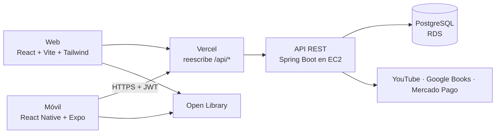

# RumboU · Frontend

Web y app móvil de **RumboU**, la plataforma de preparación para los exámenes de admisión de la UNI y la UNMSM. Consume la API de [`rumbou-backend`](https://github.com/marcobautista-sketch/rumbou-backend).

CS 2031 Desarrollo Basado en Plataformas (UTEC).

- **Integrantes:** Marco Emilio Bautista Ortega, Fabiana Marcela Gomez Chavez, Juan Carlos Alexander Vergara Montalván y Zoe Camila Garrido Cantoni

## Participación y coevaluación de los integrantes

| Integrante | Principales aportes | Participación |
| --- | --- | --- |
| Marco Emilio Bautista Ortega | Backend: autenticación con JWT y refresh tokens, motor de simulacros y calificación, banco de preguntas, liga semanal, despliegue en AWS (EC2, RDS, HTTPS) y su evidencia. Web y móvil: la mayor parte de las pantallas, el Cuaderno de errores con cámara y micrófono, los temas por universidad, la liga semanal, la publicación en Vercel y en EAS. Coordinación del equipo y documentación. | 100 % |
| Fabiana Marcela Gomez Chavez | Backend: banco de preguntas (CRUD, filtros paginados, búsqueda por texto, aprobación individual y en lote), construcción y carga del banco de 792 preguntas, revisión del proyecto contra la rúbrica, rol REVIEWER e interfaces de servicio. Web: componentes base (Card, Badge, Modal, Skeleton, Pagination, Breadcrumbs, Table), layout con Navbar y Sidebar, modo oscuro, banco de preguntas y revisión, formularios con React Hook Form y Zod, historial paginado. Móvil: rendir simulacros, historial paginado, pestañas e inicio. Despliegue del móvil con EAS y HTTPS de la API. | 100 % |
| Juan Carlos Alexander Vergara Montalván | Backend: catálogo académico (universidades, áreas, carreras, ofertas, esquemas de calificación y temas) y su carga desde CSV, módulo de progreso (objetivos, PSP, IP, semáforo, dominio por tema e historial), `ProgresoListener` y manejo de parámetros inválidos. Web: inicio con racha y meta, mis objetivos, logros, catálogo de carreras con búsqueda, filtros y detalle. | 100 % |
| Zoe Camila Garrido Cantoni | Backend: suscripción PRO con `PlanService` y límites por plan, webhook de Mercado Pago idempotente, activación y vencimiento diario de suscripciones, gamificación (racha, XP, logros y su catálogo) y correos HTML con Thymeleaf y sus listeners. | 100 % |

Coevaluación del equipo: cada integrante cumplió el 100 % de las responsabilidades que asumió.

## En producción

| Parte | Dónde | URL |
| --- | --- | --- |
| API REST | AWS EC2 detrás de nginx con HTTPS, base en RDS PostgreSQL | `https://184-194-122-22.sslip.io/api/v1` (salud: `/api/v1/health`) |
| Web | Vercel | https://rumbou-frontend.vercel.app |
| Probar desde el celular | Página pública a la que lleva el QR de la presentación: en Android instala el APK y en iPhone abre la web | https://rumbou-frontend.vercel.app/app |
| Móvil | Expo Go en iPhone y Android, y un APK para Android con EAS Build y EAS Update (proyecto `@rumbou/rumbou`, canal `preview`) | [Descargar el APK 1.1.0 para Android](https://github.com/marcobautista-sketch/rumbou-frontend/releases/download/v1.1.0/rumbou-1.1.0.apk) · entra a la API por el mismo dominio de la web |

## Arquitectura



Las dos apps siguen las mismas capas:

- `api/` (web) y `services/` (móvil): cliente axios con `baseURL`, timeout e interceptores que agregan el `Authorization: Bearer` y renuevan el token cuando la API responde 401.
- `contexts/` y `hooks/`: sesión del usuario (`AuthContext`), tema y lógica reutilizable (`useFetch`, `usePagination`, `useDebounce`).
- `components/`, `pages/` y `screens/`: la interfaz.

**Sesión.** En la web el access token vive solo en memoria y el refresh token en una cookie `HttpOnly`, así que ningún script puede leerlos desde `localStorage`. En el móvil los dos tokens se guardan cifrados con `expo-secure-store`.

## Funcionalidades

| | Web | Móvil |
| --- | --- | --- |
| Registro en 3 pasos, inicio de sesión y recuperar contraseña | ✓ | ✓ |
| Rendir simulacros (por tema, completo, diagnóstico) y ver el resultado | ✓ | ✓ |
| Historial de simulacros paginado | ✓ | ✓ |
| Panel con racha, metas, evolución del PSP y dominio por tema | ✓ | |
| Desafío diario y plan de estudio con videos y libros | ✓ | ✓ |
| Pizarra para resolver mientras rindes | ✓ | ✓ |
| Liga semanal con alias, para comparar tu actividad de la semana con la de otros postulantes | ✓ | ✓ |
| Colores según la universidad de tu meta (UNI o San Marcos), en modo claro y oscuro | ✓ | ✓ |
| Cuaderno de errores: foto del procedimiento, explicación grabada y nota por pregunta | | ✓ |
| Editar el perfil | ✓ | ✓ |
| Banco de preguntas con filtros, revisión y administración de roles | ✓ | |

Sensores del móvil: **cámara** (foto del procedimiento en el Cuaderno de errores, con la galería si no hay permiso), **micrófono** (explicación grabada de hasta 30 segundos, con la nota escrita si no hay permiso) y **huella o Face ID** (entrar sin contraseña). El cuaderno se guarda en el celular, separado por cuenta, y se conserva al cerrar la app.

Los colores salen de la meta principal, que es la meta activa más antigua: la UNI usa el granate y el beige de su manual de identidad, y San Marcos tonos inspirados en sus azules, sin escudos ni logos. Sin meta o sin sesión se usa la paleta de RumboU, y el logo no cambia.

## Cómo correrlo

Requisitos: Node.js 22 o superior y el backend corriendo (en local queda en `http://localhost:8080`).

La web llama a la API por `/api/v1` y el servidor de desarrollo reenvía esas llamadas al backend, así que la cookie de sesión es del mismo origen y no hay problemas de CORS. Los valores por defecto están en `web/.env.example`; para cambiarlos, cópialo como `web/.env.local`.

### Web

```bash
cd web
npm install
npm run dev
```

Se abre en `http://localhost:5173`.

### Móvil

```bash
cd mobile
npm install
npx expo start
```

Escanea el código QR con la app **Expo Go** (Android o iOS).

Para que el celular llegue al backend de tu PC, copia `mobile/.env.example` como `mobile/.env.local` y pon la IP de tu PC en `EXPO_PUBLIC_API_URL`: en el celular, `localhost` es el propio celular.

Para usar la API desplegada en vez de la local, define la variable antes de arrancar. En PowerShell:

```powershell
$env:EXPO_PUBLIC_API_URL = "https://rumbou-frontend.vercel.app"
npx expo start --clear
```

## Cómo desplegarlo

### Web en Vercel

1. En Vercel, **Add New → Project** e importa este repositorio.
2. En **Root Directory** elige `web`. Vercel detecta Vite solo (`npm run build`, salida `dist`).
3. No hace falta ninguna variable de entorno: [`web/vercel.json`](web/vercel.json) reenvía `/api/*` a la API en AWS y manda cualquier otra ruta a `index.html`, para que recargar `/questions` no dé 404. Como la web y la API comparten origen, no hay CORS y la cookie de sesión funciona.

### Móvil con EAS

La app de producción usa la API de [`mobile/.env.production`](mobile/.env.production). Esa URL es pública, por ende, puede ir en el repositorio.

```bash
cd mobile
npm install -g eas-cli
eas login
eas init                      # crea el proyecto en Expo y guarda su projectId en app.json
eas update:configure          # activa las actualizaciones por canal
eas build -p android --profile preview   # genera un APK que se instala con un enlace
eas update --channel preview --environment preview --message "Entrega final"
# Solo para el equipo: la misma app en Expo Go, sin laptop. Expo Go solo abre proyectos de sus miembros.
RUMBOU_EXPO_GO=1 eas update --channel expo-go --environment preview --message "Expo Go"
```

`eas build` deja un enlace para instalar el APK en Android, pero ese enlace vence a los 30 días: por eso el APK también está publicado en [Releases](https://github.com/marcobautista-sketch/rumbou-frontend/releases/latest), que es permanente. Después de eso, `eas update` publica los cambios de JavaScript sin tener que generar otro APK.
